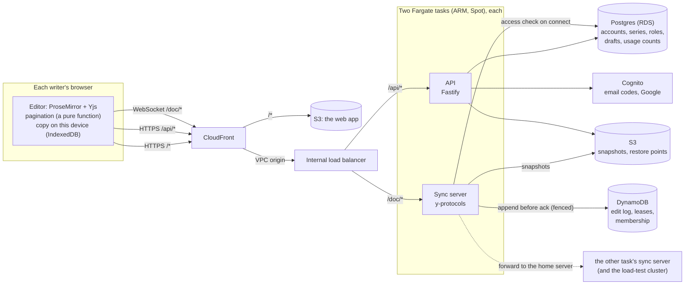

# Scripter

A real-time collaborative screenwriting tool built like a TV writers' room. Several writers edit the same episode at once with no conflicts. A writer can fork a **what-if** of an episode, rewrite scenes in it, and **send** chosen scenes back into the main script. A three-way, scene-level comparison shows what changed where, and flags when main changed the same scene too. It looks and feels like Highland: fast, quiet and out of the way of the writing, with true screenplay pages (the industry's page geometry, pagination rules and a matching PDF), Final Draft and Fountain import, and roles for a whole room (showrunner, writers, viewers).

The systems centerpiece is a horizontally scaled sync service:

- **One home server per script,** chosen by consistent hashing over the live servers.
- **Ownership leases** with fencing tokens.
- **A durable edit log:** every keystroke is stored before anyone sees it.
- **Failover with zero lost edits,** proven by a chaos suite and a load-test harness.

**Status:** feature-complete for the closed beta: editor, real-time sync, pagination and page view, PDF, import, accounts and roles, what-ifs. The AWS deploy is built and tested; it goes live at `scripter.ca`, with its servers run on demand while the beta has one tester (D-096). See `docs/SPEC.md` for the specification, `docs/decision-log.md` for every decision and why it was made, `docs/metrics.md` for measured numbers, and `docs/interview-notes.md` for the hardest problems and their tradeoffs.

## Architecture



**How a keystroke travels:**

1. The editor turns it into a Yjs update.
2. The writer's client sends it to whichever sync server it reached.
3. If that server isn't the script's home, it forwards the update there.
4. The home server appends it to the DynamoDB edit log, in a transaction that also checks it still holds the script's lease and epoch (the fencing token).
5. Only then does the home server apply the update, broadcast it to the room, and acknowledge it.
6. If a server dies, its leases expire. A new home loads the latest S3 snapshot plus the log tail, and clients resend anything unacknowledged (Yjs drops duplicates). Nothing is lost.

`docs/sync-cluster.md` has the details; `docs/interview-notes.md` has the reasoning.

## Repo layout

```
apps/
  web/           React + Vite client, plain CSS on the design tokens
  sync/          The sync server: home servers, leases, the edit log, snapshots, the 30-day purge
  api/           Fastify REST API: accounts, series, episodes, roles, invitations, what-ifs, usage
packages/
  schema/        ProseMirror schema, element types, Enter/Tab rules, the what-if comparison
  pagination/    Pure pagination function: document blocks in, lines and page breaks out
  shared/        The sync client and wire protocol, permission rules, design tokens
  auth/          Token checks for the API and sync servers (and a test-only issuer)
infra/           AWS CDK app (TypeScript) and the server images (infra/docker)
tools/
  loadtest/      Load-test harness for the sync service
docs/
  SPEC.md        Specification (product, design system, editor, architecture, plan)
  decision-log.md, metrics.md, runbook.md, interview-notes.md, sync-cluster.md
  prototype/     Interactive HTML prototype: the visual and interaction source of truth
```

## Running it locally

Requirements: Node 24.12 (see `.node-version`), corepack (ships with Node), and a container runtime (OrbStack, Docker Desktop or Colima).

```sh
corepack enable          # once per machine; provides the pinned pnpm version
pnpm install
cp .env.example .env     # local-only settings for the services below
pnpm services:up         # Postgres :5432, DynamoDB Local :8000, SeaweedFS S3 :8333
pnpm --filter @wr/api migrate
pnpm dev:api             # the API on :4100
pnpm dev:sync            # the sync server on :4000
pnpm dev:web             # the app on :5173
```

If `corepack enable` fails with `EACCES: permission denied` (it tries to write to `/usr/local/bin`), install the shims into your home folder instead:

```sh
mkdir -p ~/.local/bin
corepack enable --install-directory ~/.local/bin
echo 'export PATH="$HOME/.local/bin:$PATH"' >> ~/.zshrc && source ~/.zshrc
```

**Signing in:** there's no development sign-in stub (D-030, D-046). The API and the sync servers trust only the Cognito user pool named in `.env`, so running the app locally needs that pool, created by the `WrAuth` stack (accounts step 8). The automated tests sign in with a per-run test key instead and cover every role rule.

**A 3-server cluster:** `pnpm cluster:up` builds the sync server image and starts `sync-1`, `sync-2` and `sync-3` on `localhost:4001`-`4003` (plus the services). Point the app at all three with `VITE_SYNC_URLS=ws://localhost:4001,ws://localhost:4002,ws://localhost:4003 pnpm dev:web`. While you write, you can:

- kill one (`docker kill scripter-sync-2-1`);
- freeze one (`docker pause`, then `docker unpause`);
- stop one gracefully (`docker stop`).

`pnpm cluster:down` stops them.

**Without containers:** `WR_STORAGE=memory pnpm --filter @wr/sync dev` keeps the edit log and snapshots in the server's memory (development only). It still needs Postgres and the Cognito settings.

## Testing

| Command                                                   | What it runs                                                                                                                            |
| --------------------------------------------------------- | --------------------------------------------------------------------------------------------------------------------------------------- |
| `pnpm check`                                              | Format check, lint, typecheck and every test that needs no containers: the pre-commit gate                                              |
| `pnpm test`                                               | Vitest, one project per workspace folder. The web tests run in real Chromium (`pnpm --filter @wr/web exec playwright install chromium`) |
| `pnpm test:services`                                      | With `pnpm services:up`: the API on Postgres, and the sync server's DynamoDB and S3 storage and fencing                                 |
| `pnpm --filter @wr/sync test:chaos`                       | Three real server processes: one SIGKILLed mid-typing, one frozen until it's fenced off, servers added and removed                      |
| `pnpm loadtest <rooms\|room15\|failover\|ramp> --local 3` | The load-test harness against local server processes (results in `tools/loadtest/results/`)                                             |
| `WR_BROWSERS=webkit,firefox pnpm test`                    | The web tests in Safari's and Firefox's engines too                                                                                     |

The web suite includes an accessibility audit (contrast, names and focus on every screen, in both themes), a parity check against the prototype, and performance budgets on a 110-page script with three writers.

## Deploying

The CDK app in `infra/src` defines the accounts stacks (`WrBudgets`, `WrEmail`, `WrAuth`) and the beta:

- **`WrData`:** Postgres, DynamoDB, S3 and the network, all kept forever;
- **`WrDns`:** the domain's Route 53 zone (the domain is registered at Porkbun);
- **the certificate** for the site and `auth.<domain>`, the sign-in domain: made by `infra/scripts/cert.sh` in us-east-1, where the AWS free plan forbids stacks (D-099);
- **`WrApp`:** CloudFront, the sign-in domain, the load balancer and two tasks, the daily purge, and the alarms. `pnpm --filter @wr/infra beta:up` / `beta:down` brings the servers up or takes them away (the site stays up);
- **`WrLoad`:** the temporary load-test cluster.

Settings come from the git-ignored `infra/.env.local` (see `infra/.env.local.example`). The procedure, checks, alarms and recovery steps are in `docs/runbook.md`.

## Scripts

| Command                              | What it does                                                 |
| ------------------------------------ | ------------------------------------------------------------ |
| `pnpm check`                         | Format check, lint, typecheck and tests: the pre-commit gate |
| `pnpm typecheck`                     | `tsc --noEmit` in every package                              |
| `pnpm lint`                          | ESLint with type-aware rules                                 |
| `pnpm format`                        | Prettier (skips `docs/`)                                     |
| `pnpm services:up` / `services:down` | Start or stop the local services                             |
| `pnpm cluster:up` / `cluster:down`   | The local 3-server sync cluster                              |

## Local services

| Service                     | Stands in for                                            | Port |
| --------------------------- | -------------------------------------------------------- | ---- |
| Postgres 18.6               | Users, series, episodes, roles, drafts, snapshot records | 5432 |
| DynamoDB Local 3.3.1        | Edit log, ownership leases, server membership            | 8000 |
| SeaweedFS 4.48 (S3 gateway) | S3 snapshot storage                                      | 8333 |

The credentials in `docker-compose.yml`, `.env.example` and `infra/local/` are for local development only.
